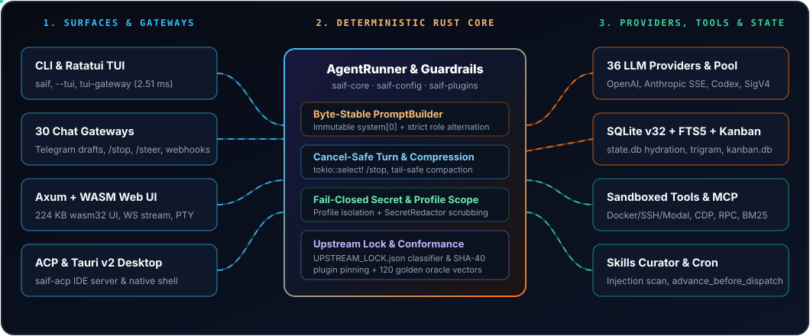
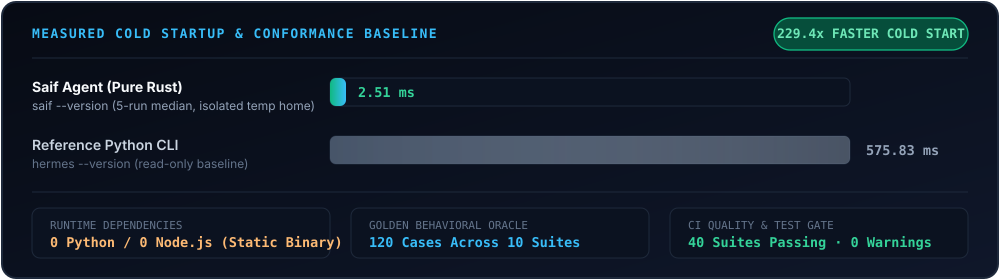

<div align="center">



<br/>

[](https://github.com/ridloabelian/saif-agent/actions/workflows/ci.yml)
[](https://github.com/ridloabelian/saif-agent/releases)
[](https://github.com/ridloabelian/saif-agent/actions/workflows/upstream-watch.yml)
[](LICENSE)
[](#workspace-crates)
[](#performance--conformance-benchmarks)

<p>
  <a href="#quickstart"><b>Quickstart</b></a> ·
  <a href="#interactive-demo"><b>Interactive Demo</b></a> ·
  <a href="#system-architecture--core-invariants"><b>Architecture &amp; Invariants</b></a> ·
  <a href="#performance--conformance-benchmarks"><b>Benchmarks</b></a> ·
  <a href="#cli-commands"><b>CLI Commands</b></a> ·
  <a href="#workspace-crates"><b>Workspace Crates</b></a> ·
  <a href="#upstream-sync"><b>Upstream Sync</b></a>
</p>

</div>


## Why Saif Agent?

<table>
  <tr>
    <td width="215" align="center" valign="middle">
      
    </td>
    <td valign="middle">
      <p>
        <strong>Saif Agent (<code>saif-agent</code>)</strong> is an independent <strong>100% pure-Rust autonomous self-improving AI agent</strong> engineered for single-binary speed, deterministic memory safety, and zero interpreter overhead — while preserving seamless compatibility with the Hermes agent ecosystem (<code>~/.saif</code>, <code>saif migrate --from-hermes</code>, skills, and multi-profile isolation).
      </p>
      <ul>
        <li><strong>Single Static Binaries</strong> — Compiles cleanly to <code>saif</code> (<code>14 MB</code>) and <code>saif-acp</code> (<code>11 MB</code>) with bundled SQLite FTS5, <code>rustls</code> TLS, and an embedded <code>224 KB</code> WASM dashboard.</li>
        <li><strong>Verified Behavioral Parity</strong> — Tested against <strong>120 golden oracle vectors</strong> across 10 <code>.jsonl</code> suites and <strong>40 automated E2E &amp; unit suites</strong> with zero compiler warnings.</li>
        <li><strong>Continuous Upstream Tracking</strong> — Classifies upstream diffs automatically via <code>conformance/UPSTREAM_LOCK.json</code> and <code>saif upstream diff --port-only</code>.</li>
      </ul>
    </td>
  </tr>
</table>


## Interactive Demo

Experience native sub-10 ms cold starts across the `ratatui` TUI (`saif --tui`), single-shot CLI queries (`saif -q`), the `axum` + pure-Rust `wasm32` Web Dashboard (`saif dashboard`), and IDE integrations via `saif-acp`:

<div align="center">
  
</div>


## System Architecture & Core Invariants

All messaging surfaces, interactive UIs, tools, providers, and persistence layers converge on a deterministic Rust core guarded by **8 non-negotiable architectural invariants**:

<div align="center">
  
</div>

<br/>

<details open>
<summary><b>🛡️ The 8 Core Architectural Invariants</b></summary>

| # | Invariant | Guaranteed Behavior | Primary Crate |
|---|---|---|---|
| **1** | **Byte-Stable `system[0]`** | Prompt prefix &amp; tool definitions stay byte-identical across turns to preserve provider KV cache hits; `/steer` &amp; hints inject via user/tool messages | `saif-core` |
| **2** | **Strict Role Alternation** | Validates conversation turns before every LLM call to forbid double consecutive user messages while allowing legal `/steer` after tool output | `saif-core` |
| **3** | **Fail-Closed `SecretScope`** | Secondary multiplexed profiles never inherit launch-profile environment secrets; child subprocess envs are stripped via `build_child_env()` | `saif-config` |
| **4** | **4-Invariant Draft Streaming** | Progressive prefix-stable draft frames, explicit `finish(final_text)`, `_interim_send`, and `edit_message` reconciliation before fallback send | `saif-gateway` |
| **5** | **At-Most-Once Cron Dispatch** | Advances `next_run_at` before execution (`advance_before_dispatch`), enforces bounded catch-up grace windows, `.tick.lock`, &amp; 600s watchdog | `saif-cron` |
| **6** | **SHA-40 Plugin Pinning &amp; Kill-List** | Catalog manifests require 40-hex commit SHA pins, check against `removed.yaml`, and isolate host plugins behind stdio JSON-RPC | `saif-plugins` |
| **7** | **8,192-Char FTS5 Trigram Indexing** | Schema v32 (`state.db`) caps FTS5 tool content indexing at `8,192` chars with trigram search, query sanitization, &amp; one-line previews | `saif-persistence` |
| **8** | **Boundary-Guarded Profile Isolation** | `ProfileScope` enforces 6-marker identity checks, `FileAtHomeBoundary`, and `.deleted/` tombstone refusal so deleted profiles never resurrect | `saif-config` |

</details>


## Performance & Conformance Benchmarks

Measured directly on this repository's release builds (`--version` median across isolated temporary `SAIF_HOME` runs) and workspace CI quality gate:

<div align="center">
  
</div>


## Feature Highlights

<table>
  <tr>
    <td width="33%" valign="top">
      <h4>🔌 36 LLM Providers &amp; Auth Failover</h4>
      <p>Native OpenAI Chat, Anthropic Messages (SSE streaming + <code>cache_control</code>), Codex <code>/responses</code>, and pure-Rust AWS SigV4 Bedrock, backed by <code>CredentialPool</code> &amp; <code>auth.json</code> rotation on HTTP <code>401</code>/<code>403</code>/<code>429</code>.</p>
    </td>
    <td width="33%" valign="top">
      <h4>💬 30 Messaging Gateways</h4>
      <p>Unified <code>GatewayMultiplexer</code> supporting Telegram draft streaming, Discord, Slack, WhatsApp, Matrix, Signal, Feishu, Email, OpenAI-compat HTTP server, outbound webhooks, plus dual busy guards (<code>/stop</code>, <code>/steer</code>, <code>/new</code>).</p>
    </td>
    <td width="33%" valign="top">
      <h4>🧰 Sandboxed Tools, CDP &amp; MCP</h4>
      <p>Local, Docker, SSH, Modal, Daytona, and Vercel execution backends, 9-strategy <code>fuzzy_match</code>, V4A patches, BM25 <code>tool_search</code>, WebSocket CDP browser vault + redaction, RPC <code>execute_code</code>, and trusted MCP tools.</p>
    </td>
  </tr>
  <tr>
    <td width="33%" valign="top">
      <h4>🧠 Self-Improving Skills &amp; Security</h4>
      <p>60-char prompt skill index, multi-scope <code>scan_for_threats</code> injection scanner (including invisible Unicode), usage telemetry, non-destructive <code>Curator</code> archiving, and automatic secret redaction in tool previews.</p>
    </td>
    <td width="33%" valign="top">
      <h4>🗄️ SQLite v32, FTS5 &amp; Kanban</h4>
      <p>Crash-safe SQLite session hydration, durable 2-tier context compaction across restarts, cross-profile CAS-claimed <code>kanban.db</code> dependency queues, and scheduled cron execution.</p>
    </td>
    <td width="33%" valign="top">
      <h4>🖥️ TUI, 224 KB WASM Web UI &amp; Desktop</h4>
      <p>Zero-JS-framework <code>ratatui</code> TUI, <code>axum</code> WebSocket dashboard with embedded <code>wasm32-unknown-unknown</code> terminal UI (<code>saif_web_ui.wasm</code>), native <code>saif-acp</code> editor server, and Tauri v2 desktop shell.</p>
    </td>
  </tr>
</table>


## Quickstart

```bash
# Option A: One-line installer (Linux / macOS, SHA-256 verified)
curl -fsSL https://raw.githubusercontent.com/ridloabelian/saif-agent/main/install.sh | sh

# Option B: Windows PowerShell (SHA-256 verified)
irm https://raw.githubusercontent.com/ridloabelian/saif-agent/main/install.ps1 | iex

# Option C: Multi-arch Container (linux/amd64 & linux/arm64)
docker run --rm -it -v ~/.saif:/data/.saif ghcr.io/ridloabelian/saif-agent:latest status

# Option D: Build from source (`saif`, `saif-acp`)
cargo build --release --bins

# Verify runtime readiness, providers, and active profile status
saif doctor
saif status

# Run a single-shot prompt, launch the native TUI, or open the WASM web dashboard
saif -q "Summarize active cron jobs and recent sessions"
saif --tui
saif dashboard

# Preview non-destructive multi-profile migration from ~/.hermes -> ~/.saif
saif migrate --from-hermes --dry-run
```

## CLI Commands

<details>
<summary><b>📖 Full CLI Subcommand Reference (20 Subcommands)</b></summary>

| Command | Description |
|---|---|
| `saif chat` | Interactive chat REPL or native `ratatui` TUI (`--tui`) |
| `saif tui-gateway` | NDJSON stdio JSON-RPC 2.0 backend (`tui_gateway` compatible) |
| `saif status` | Show active profile, config, provider route, model, and session counts |
| `saif doctor` | Inspect runtime readiness, binary paths, `SAIF_HOME`, providers, and security state |
| `saif config` | Read or atomically update configuration &amp; profile secrets |
| `saif profile` | Manage isolated multi-tenant profiles under `~/.saif/profiles/<name>` |
| `saif sessions` | Search and inspect SQLite v32 / FTS5 session history |
| `saif skills` | Manage, index, and security-scan `SKILL.md` skills |
| `saif curator` | Skill lifecycle curator telemetry, tar.gz backups, and archival |
| `saif cron` | Create, list, and execute scheduled cron jobs (`saif cron tick`) |
| `saif kanban` | Cross-profile SQLite Kanban task board with dependency tracking |
| `saif gateway` | Run 30-platform messaging &amp; OpenAI-compatible HTTP gateway (`gateway run`) |
| `saif serve` | Headless backend server for the Tauri v2 desktop shell |
| `saif dashboard` | Pure-Rust `axum` + WebSocket PTY + `wasm32` web dashboard |
| `saif plugins` | Inspect, verify SHA-40 pins, and validate plugin manifests &amp; hooks |
| `saif mcp` | Manage MCP stdio servers and per-profile trust state |
| `saif migrate` | Non-destructive multi-profile migration from `~/.hermes` into `~/.saif` |
| `saif batch` | Parallel JSONL batch runner with ShareGPT export &amp; `--resume` |
| `saif auth` | Manage multi-credential auth failover pool &amp; rotation `strategy` |
| `saif upstream` | Track, diff (`--port-only`), and acknowledge `NousResearch/hermes-agent` updates |

</details>


## Workspace Crates

| Crate | Purpose |
|---|---|
| `saif-platform` | OS/arch facts, deterministic binary resolution, `(pid, start_time)` process identity, parent-first tree termination |
| `saif-config` | Task-local `ProfileScope` (boundary-guarded), fail-closed `SecretScope`, structured `redact_sensitive_text`, 3 YAML loaders (`load_effective_saif_config`), `SkinConfig`, i18n, multi-profile Hermes migration, `UpstreamLock` diff classifier |
| `saif-persistence` | `state.db` Schema v32 (`SqliteStore` + `compact_session_history`) + FTS5 v3 (8,192-char tool cutoff + trigram + sanitizer) + `kanban.db` (`KanbanStore`) |
| `saif-providers` | `36` built-in `ProviderProfile`s, OpenAI + Anthropic (SSE streaming + `cache_control`) + Codex `/responses` + pure-Rust AWS SigV4 Bedrock + live `CredentialPool`/`auth.json` failover |
| `saif-skills` | `SKILL.md` frontmatter parser, 60-char index rule, `scan_for_threats` injection scanner, `.usage.json`, `Curator` |
| `saif-cron` | Natural/cron5/ISO schedule parser, catch-up grace window, `advance_before_dispatch`, `.tick.lock`, live execution + 600s watchdog |
| `saif-plugins` | `plugin.yaml` loader, SHA-40 catalog &amp; `removed.yaml` enforcer, `HookRegistry` + `PluginHookBridge`, stdio `PluginHostClient` |
| `saif-tools` | `ToolRegistry`, BM25 `tool_search`, `delegate_task`, 9-strategy `fuzzy_match`, V4A `patch_parser`, Local/Docker/SSH/Modal/Daytona/Vercel envs, WebSocket CDP + `BrowserVault` + redaction, `execute_code` loopback RPC kernel, trusted MCP tool registration, `computer_use`, TTS/STT/Image/Video media tools |
| `saif-core` | `PromptBuilder` (byte-stable prefix), `ContextCompressor`, `AgentRunner` (SQLite session hydration, durable compaction, cancel-safe `/stop` &amp; `/steer`, `delegate_task`, `KanbanStore`), parallel ShareGPT `--resume` `batch` runner |
| `saif-rpc-contract` | Shared WASM-compatible JSON-RPC 2.0 &amp; dashboard view types |
| `saif-tui` | Native `ratatui` + `crossterm` TUI (`saif --tui`) + stdio `tui-gateway` |
| `saif-gateway` | `RoutingIdentity`, dual busy guard (`/stop`/`/steer`/queue drain), 4-invariant progressive `StreamDraftController`, `30` platform specs, `GatewayMultiplexer` + outbound webhooks, systemd/launchd/Windows service units |
| `saif-web` | `axum` REST/WS (real-time streaming + `turn.cancel`, CSP, 404 fallback, `/assets/saif_web_ui.wasm`) + POSIX PTY bridge + multi-tab pure-Rust/WASM dashboard host |
| `saif-acp` | Native Agent Client Protocol stdio server (`saif-acp`) |
| `saif-cli` | Unified `saif` CLI &amp; REPL binary (`auth`, `batch`, `gateway`, `profile`, `cron`, `kanban`, `migrate`, `dashboard`, `serve`, `upstream`) |
| `saif-conformance` | `120` golden oracle cases (`conformance/cases/*.jsonl`) + Waves 1–6 &amp; Phases 1–7 runtime E2E suites |
| `apps/saif-web-ui` | Pure-Rust `wasm32-unknown-unknown` UI crate with linear-memory FFI (`saif_ui_feed_pty`, `saif_ui_apply_event`), `TerminalScreenBuffer` &amp; `\x1b[RESIZE:<cols>;<rows>]` control frames |
| `apps/saif-desktop` | Pure-Rust Tauri v2 Desktop shell (`build.rs`, `ServeSidecarConfig`, detached `gateway run`, SHA-256 updater check) |


## Upstream Sync

Track and port future improvements from [`NousResearch/hermes-agent`](https://github.com/NousResearch/hermes-agent) without noise using an isolated temporary `SAIF_HOME`:

```bash
TMP_HOME=$(mktemp -d)
SAIF_HOME="$TMP_HOME" saif upstream status
SAIF_HOME="$TMP_HOME" saif upstream diff --port-only
# After porting changes + adding tests + passing CI checks:
SAIF_HOME="$TMP_HOME" saif upstream ack <HEAD_SHA> --subject "<commit summary>"
rm -rf "$TMP_HOME"
```

### Documentation

- [docs/HERMES_ANATOMY.md](docs/HERMES_ANATOMY.md) — End-to-end technical dissection of all 14 subsystems &amp; 8 invariants
- [docs/UPSTREAM_SYNC.md](docs/UPSTREAM_SYNC.md) — 4-step workflow for tracking &amp; porting upstream updates
- [rust/MAP.md](rust/MAP.md) — Complete Wave 1–6 &amp; Phases 1–7 implementation tracker &amp; verification metrics
- [rust/DECISIONS.md](rust/DECISIONS.md) — Architecture Decision Records (`ADR-001`..`ADR-011`)
- [rust/GLOSSARY.md](rust/GLOSSARY.md) — 1:1 symbol mapping (`hermes-agent` → `saif-agent`)

## Acknowledgments

Saif Agent draws upon the foundational agent architecture, SQLite/FTS5 state schema, and behavioral specifications of [`NousResearch/hermes-agent`](https://github.com/NousResearch/hermes-agent) (MIT License). Saif Agent is an independent pure-Rust implementation and is not affiliated with, endorsed by, or sponsored by Nous Research.

## License

Released under the [MIT License](LICENSE). See [NOTICE](NOTICE) for upstream attribution details and [SECURITY.md](SECURITY.md) for responsible vulnerability reporting.
